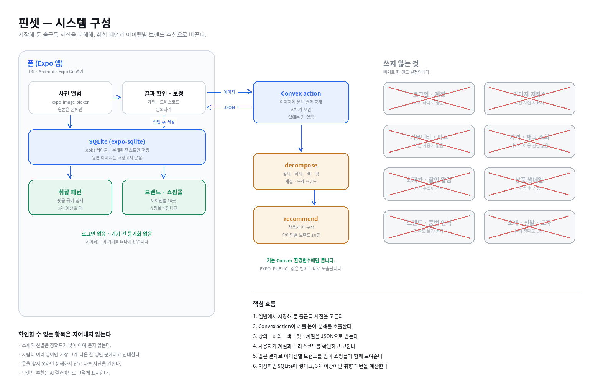

# 핀셋 (pinset)

저장해 둔 출근룩 사진을 뜯어서, 내 취향 패턴과 아이템별 브랜드를 찾아 주는 앱입니다.

와플스튜디오 24.5기 Product Engineering 세미나 과제로 만들었습니다.

## 왜 만들었나

출근룩 레퍼런스는 핀터레스트나 인스타그램에 저장해 둡니다. 그런데 저장함은 이미지 더미라서, 다시 열어도 무엇을 사야 할지는 알 수 없습니다. 그 룩이 왜 좋아 보였는지가 언어로 남지 않기 때문입니다.

실제로 저장해 둔 네 장을 뜯어보면 공통점이 보입니다. 상의에 볼륨이나 레이어드가 있고, 하의는 와이드이며, 전체가 뉴트럴 톤입니다. 하지만 저장함을 볼 때는 이 패턴이 보이지 않습니다. 그래서 쇼핑할 때마다 처음부터 다시 고릅니다.

자세한 내용은 [Pitch](docs/01-pitch.md)에 있습니다.

## 무엇을 하나

**사진 한 장을 고르면 셋이 한 번에 나옵니다.**

1. **분해** — 상의·하의의 종류, 색, 핏, 실루엣, 계절, 드레스코드
2. **브랜드** — 착용자 한 문장과 아이템별 브랜드 10곳, 각 브랜드마다 쇼핑몰 네 곳 링크
3. **패턴** — 저장이 쌓이면 반복되는 핏 조합을 문장으로



## 만들면서 정한 것

**확인할 수 없는 항목은 지어내지 않습니다.**
이미지 4장으로 측정했더니 소재는 0/4, 신발은 2/4였습니다. 정확도가 낮은 항목은 아예 묻지 않습니다. 계절과 드레스코드는 추정값을 미리 선택해 두고 사용자가 칩 하나로 고칩니다. 사람이 여러 명이면 한 명만 분해하고 알려 주고, 옷이 없으면 분해하지 않습니다.

**원본 이미지를 저장하지 않습니다.**
입력은 대부분 타인의 사진입니다. 서버에 올려 다시 보여주면 권리 문제가 생깁니다. 분해된 텍스트만 폰의 SQLite에 남기고, 그것만으로 패턴과 추천이 동작합니다.

**가격 대신 쇼핑몰 링크를 여러 개 둡니다.**
앱 안에서 가격을 보여주려면 쇼핑몰의 상품 데이터를 가져올 권한이 필요한데, 확인하지 못했습니다. 그래서 브랜드를 추천하고 각 브랜드마다 쇼핑몰 네 곳의 검색 링크를 둡니다. 사용자가 하나씩 눌러 가격을 비교합니다. 제약은 그대로 두되 목적은 달성하는 구조입니다.

**패턴은 핏을 묶어서 셉니다.**
상·하의 최빈값을 따로 뽑으면 실제로 저장한 적 없는 조합이 만들어집니다. 핏을 붙는·적당한·넉넉한 세 묶음으로 바꿔 조합 단위로 세고, 같은 조합이 두 번 이상 나와야 패턴이라고 말합니다. 개별 카드에는 원값을 그대로 보여줍니다.

## 앞으로

- **상품 썸네일** — 지금은 쇼핑몰 검색으로 넘깁니다. 제휴를 맺으면 앱 안에서 유사 상품을 이미지로 보여줄 수 있습니다.
- **체형 기준 판단** — 본인 체형과 과거 기록을 대조해 주의할 점을 표시합니다.
- **출처 되찾기** — 저장한 사진이 어디서 왔는지 복원합니다.
- **문의 채널** — 잘못 분류됐을 때 보낼 수 있는 상담 창구를 붙입니다.

## 구성

```
docs/        Pitch, 설계 문서, 다이어그램, 호출 샘플
mobile/      Expo 앱
  src/app/   화면
  src/lib/   SQLite
  convex/    decompose, recommend action
```

## 실행

```
cd mobile
npm install
npx convex dev        # 다른 탭에서 켜 둡니다
npx expo start
```

API 키는 Convex 환경변수에 둡니다. 앱 코드와 저장소에는 들어가지 않습니다.

```
npx convex env set ANTHROPIC_API_KEY <key>
```

## 기술

Expo (React Native) · Convex · SQLite · Claude Haiku
