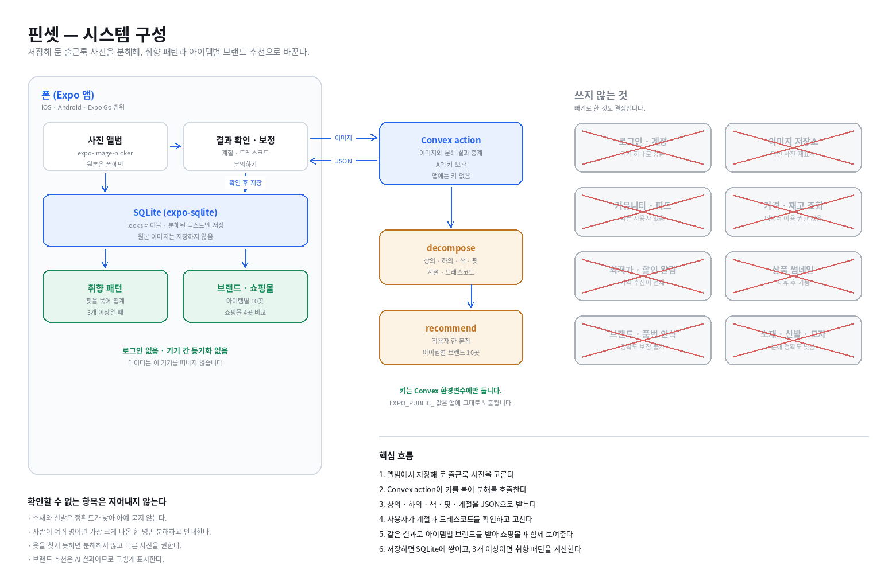

# System Design — 핀셋 (pinset)

## Overview

폰에서 도는 Expo 앱 하나와, AI 호출을 중계하는 Convex action 두 개로 이루어집니다.

저장해 둔 출근룩 사진을 분해하고 브랜드를 추천하려면 멀티모달 LLM을 호출해야 하고, 그 호출에는 API 키가 필요합니다. 키를 앱에 넣으면 그대로 노출되므로 서버가 필요합니다. Convex action은 그 두 가지 호출만 중계하며, 아무 데이터도 저장하지 않습니다.

분해 결과는 전부 폰의 SQLite에 쌓입니다. 취향 패턴은 저장된 태그를 집계하는 일이라 서버 없이 폰에서 계산합니다.

## Diagram

## Core flow

1. 앨범에서 저장해 둔 출근룩 사진을 고른다 — 폰 (`expo-image-picker`, quality 0.6으로 압축)
2. 이미지를 `decompose` action으로 보낸다 — 폰 → Convex
3. action이 환경변수의 키를 붙여 Claude Haiku를 호출한다 — Convex → LLM
4. 상의·하의의 종류·색·핏, 실루엣, 계절, 드레스코드를 JSON으로 받는다 — LLM → Convex → 폰
5. 사용자가 계절과 드레스코드를 칩으로 확인하고 고친다 — 폰
6. 같은 결과를 `recommend` action으로 보내 아이템별 브랜드 10곳을 받는다 — 폰 → Convex → LLM → 폰
7. 저장하면 SQLite에 쌓이고, 같은 묶음이 3개 이상이면 취향 패턴을 계산한다 — 폰

## Data

데이터는 전부 폰의 SQLite(`expo-sqlite`)에 둡니다. 원본 이미지는 저장하지 않고 분해된 텍스트만 남깁니다.

**looks**
`id INTEGER PK AUTOINCREMENT, createdAt INTEGER, payload TEXT`

`payload`는 분해 결과 전체를 담은 JSON입니다. 스키마가 자주 바뀌는 단계라 컬럼으로 펼치지 않고 통째로 저장합니다.

**키: `id`.**
같은 사진을 두 번 분해해도 사용자가 두 번 저장한 것이므로 다른 행입니다. 중복을 막지 않는 것이 의도입니다. 사진은 저장하지 않으므로 내용으로 같은 행을 식별할 방법이 없고, 같은 룩을 반복 저장하는 것 자체가 취향 신호이기 때문입니다.

브랜드 추천 결과는 저장하지 않습니다. 매번 다시 받는 쪽이 최신이고, 저장해도 재사용 시점이 없습니다.

`AsyncStorage`와 `SecureStore`는 쓰지 않습니다. 앱이 보관할 비밀 값이 없습니다.

## Data sources

**① 저장해 둔 이미지 — 폰 기능 (사진 앨범 권한)**

`expo-image-picker`로 앨범에서 고릅니다. Expo Go에서 동작하므로 development build가 필요 없습니다. 사용자가 요청할 때만 가져오고, 앱이 앨범을 훑지 않습니다.

한계: 인스타그램이나 핀터레스트 앱 안의 저장함에는 접근할 수 없습니다. 스크린샷을 찍어 앨범에 둔 것만 가져올 수 있습니다. 공유 익스텐션으로 해결되지만 development build가 필요해 제외했습니다.

원본 크기로 보내면 요청이 너무 커서 실패합니다. `quality: 0.6`으로 압축해 보냅니다.

**② 이미지 분해 — Claude Haiku (멀티모달)**

실제로 불러본 결과: `docs/samples/decompose-sample.json`, `docs/samples/decompose-live.json`

출근룩 이미지 4장으로 확인했습니다. 상의·하의의 종류와 색, 실루엣은 4/4 정확했습니다. 신발은 2/4만 가능했고, 바지에 가리거나 프레임 밖인 경우 판단할 수 없었습니다. 소재는 0/4로 어느 장에서도 확정하지 못했습니다.

이 결과를 보고 설계를 바꿨습니다. **소재·신발·모자·가방은 아예 묻지 않습니다.** 정확도가 낮은 항목을 지우는 것이 비워 두는 것보다 낫다고 판단했습니다. 계절과 드레스코드는 추정이 가능하되 틀릴 수 있어, 추정값을 미리 선택해 두고 사용자가 칩으로 고칩니다.

사람이 여러 명이면 가장 크게 나온 한 명만 분해하고 `multiple: true`를 함께 돌려받아 화면에 안내합니다. 옷을 알아볼 수 없으면 `{"error": "no_clothes"}`만 돌려받고 분해하지 않습니다.

한계: 호출당 비용이 들고, 네트워크가 없으면 분해할 수 없습니다.

**③ 브랜드 추천 — Claude Haiku (텍스트)**

분해 결과와 성별을 넣어 착용자 한 문장과 아이템별 브랜드 10곳을 받습니다. 상의·겹쳐 입은 이너·하의 각각에 따로 추천합니다.

한계: LLM이 존재하지 않는 브랜드를 만들어낼 수 있습니다. 화면에 "AI 추천이라 실제와 다를 수 있어요"를 표시하고, 탭하면 쇼핑몰 검색으로 연결해 결과가 비어도 치명적이지 않게 했습니다.

응답이 길어 5~10초 걸립니다. 분해 결과를 먼저 보여주고 브랜드는 뒤이어 채웁니다.

**④ 쇼핑몰 가격 — 쓰지 않음**

앱 안에서 가격을 보여주려면 각 쇼핑몰의 상품 데이터를 가져와야 합니다. 무신사·29CM·지그재그의 공개 자료에서 외부 앱이 전 상품 가격을 조회·저장·재표시할 수 있는 API와 이용 조건은 확인하지 못했습니다. 큐레이터 프로그램은 링크 공유 권한이지 데이터 이용 권한이 아닙니다. 네이버 쇼핑 검색 API는 2026년 7월 31일 종료됐습니다. 크롤링은 데이터베이스권과 부정경쟁방지법 문제가 있어 제외했습니다.

대신 브랜드마다 쇼핑몰 네 곳의 검색 링크를 두어, 사용자가 하나씩 눌러 가격을 비교하게 했습니다. 앱이 가격을 못 가져오는 제약은 그대로 두되 목적은 달성하는 구조입니다.

## Decisions

### AI 호출은 Convex action을 거친다

| | |
|---|---|
| 선택지 | 앱에서 직접 호출 · Convex action 경유 · 기기 내 모델 |
| 고른 것 | Convex action 경유 |
| 이유 | API 키를 앱에 넣으면 그대로 노출됩니다. `EXPO_PUBLIC_`으로 시작하는 값은 빌드에 포함됩니다. 기기 내 모델은 Expo Go에서 돌지 않습니다. |
| 대가 | 네트워크가 없으면 동작하지 않고, 호출마다 비용이 듭니다. |

### 정확도가 낮은 항목은 묻지 않는다

| | |
|---|---|
| 선택지 | 전부 묻고 빈 값 허용 · 정확도 낮은 항목 제거 · 전부 사용자 입력 |
| 고른 것 | 소재·신발·모자·가방 제거, 계절·드레스코드는 추정 후 칩으로 보정 |
| 이유 | 측정 결과 소재 0/4, 신발 2/4였습니다. 틀린 값을 보여주면 전체 신뢰가 떨어지고, 매번 되묻는 절차는 사용자가 중간에 그만두는 원인이 됩니다. |
| 대가 | 신발을 기준으로 한 추천과 패턴은 불가능합니다. |

### 가격 대신 쇼핑몰 링크를 여러 개 둔다

| | |
|---|---|
| 선택지 | 앱 안에 가격 표시 · 최저가 비교 · 브랜드별 쇼핑몰 링크 |
| 고른 것 | 브랜드별 쇼핑몰 링크 네 곳 |
| 이유 | 가격 데이터를 가져올 권한이 확인되지 않았습니다. 링크는 권한이 필요 없고, 사용자는 한 번 더 탭해서 가격을 봅니다. |
| 대가 | 앱 안에서 가격을 비교할 수 없고, 상품 썸네일도 보여줄 수 없습니다. 제휴가 성사되면 다시 검토합니다. |

### 패턴은 핏을 묶어서 센다

| | |
|---|---|
| 선택지 | 핏 원값으로 집계 · 상·하의 최빈값 따로 · 핏을 묶어 조합으로 집계 |
| 고른 것 | 붙는·적당한·넉넉한 세 묶음으로 바꿔 조합 단위로 집계 |
| 이유 | 상·하의 최빈값을 따로 뽑으면 실제로 저장한 적 없는 조합이 만들어집니다. 핏 원값은 열 가지라 저장이 쌓여도 겹치지 않습니다. |
| 대가 | "크롭 + 부츠컷"처럼 세밀한 패턴은 잡히지 않습니다. 화면의 개별 카드에는 원값을 그대로 보여줍니다. |

### iOS와 Android 둘 다 내되 Expo Go 범위 안에서만 만든다

| | |
|---|---|
| 선택지 | 한쪽만 · 둘 다 (Expo Go) · 둘 다 (development build) |
| 고른 것 | 둘 다, Expo Go 범위 |
| 이유 | 앨범 접근과 네트워크 호출뿐이라 Expo Go에서 전부 됩니다. |
| 대가 | 공유 익스텐션을 쓸 수 없어, 인스타그램에서 바로 보내는 흐름을 포기하고 앨범에서 고르는 방식으로 좁혔습니다. |
| 현황 | Android는 EAS로 APK를 빌드해 배포했습니다. iOS는 Apple Developer 계정이 필요해 이번 베타에서는 Expo Go로만 확인했습니다. |
